<div align="center">

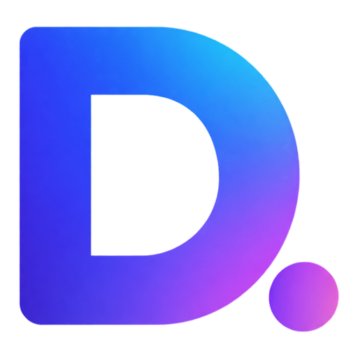

# Design Studio: Free Offline Canva Alternative for Windows

**Make social media posts, presentations, posters, menus and résumés on your PC. No internet, no account, no subscription.**

<a href="https://github.com/bhittu21/canva-offline-alternative/releases/latest/download/Design-Studio-Setup.exe"></a>

<a href="https://github.com/bhittu21/canva-offline-alternative/releases/latest"></a>
<a href="https://github.com/bhittu21/canva-offline-alternative/releases"></a>


**[🌐 Website](https://bhittu21.github.io/canva-offline-alternative/)**

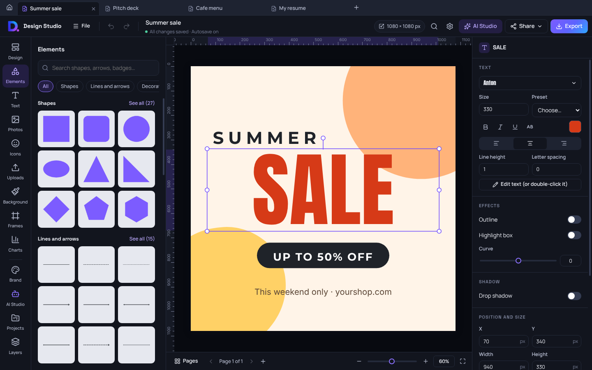

</div>

**Design Studio is a free graphic design app for Windows 10 and 11 that works completely offline.** It is built for people who like easy, drag-and-drop design tools such as Canva but want their work to stay on their own computer. It comes with **1,190 ready-made templates**, every one of them fully editable. There is no login and nothing is uploaded. Designs are saved as files on your PC. AI tools are there if you want them, using a free AI that runs on your PC or your own API key.

## Download and install (2 minutes)

1. **[Click here to download Design Studio](https://github.com/bhittu21/canva-offline-alternative/releases/latest/download/Design-Studio-Setup.exe)** (`Design-Studio-Setup.exe`). This link always gets the newest version.
2. Open the file you downloaded. If Windows says **"Windows protected your PC"**, click **More info** and then **Run anyway**. This message appears because the app is new and not yet code-signed.
3. Follow the installer. It does not need administrator rights. When it finishes, open **Design Studio** from the desktop or the Start menu.

That's it. No sign-up, no email, no credit card.

> To uninstall: Windows **Settings › Apps › Design Studio › Uninstall**. Your saved designs are kept.

## Why people choose Design Studio

| | |
| --- | --- |
| 🔒 **100% private** | Your designs never leave your PC unless you choose an online feature and say yes. |
| ✈️ **Works offline** | Design on a plane, in a classroom or anywhere without Wi-Fi. |
| 🙅 **No login** | No account, no subscription, no ads, no watermark. |
| 🎨 **1,190 templates** | Social posts, stories, slides, posters, menus, résumés, certificates, calendars and more. |
| ✏️ **Everything is editable** | Change any text, colour, font, photo, shape or layout. |
| 🗂️ **Tabs** | Work on several designs at once, like tabs in a web browser. |
| 💾 **Never lose work** | Unsaved work is kept safe and comes back after you close the app, even after a crash. |
| 🤖 **AI ready** | Optional AI writing, design and layout help. Use a free local AI or plug in your own key. |
| 🌙 **Dark mode** | Easy on the eyes, day or night. |

## Feature tour

### Start in seconds
Pick a size (Instagram post, story, YouTube thumbnail, A4, presentation, poster, business card) or type what you need, like "menu" or "resume", to find a template.

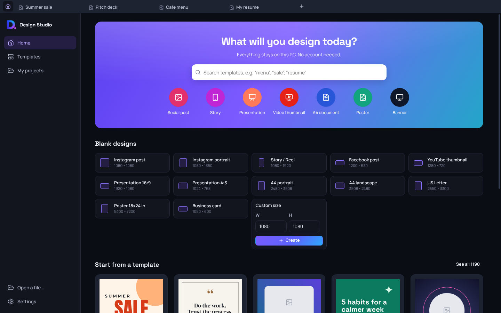

### 1,190 ready-made templates
Every template is original and was checked to make sure all its text and shapes can be edited. Categories include social media posts, Instagram and Facebook stories, YouTube thumbnails and banners, flyers and posters, invitations and cards, business cards, letterheads, invoices, certificates, résumés and cover letters, planners, calendars, worksheets, presentations, menus and price lists.

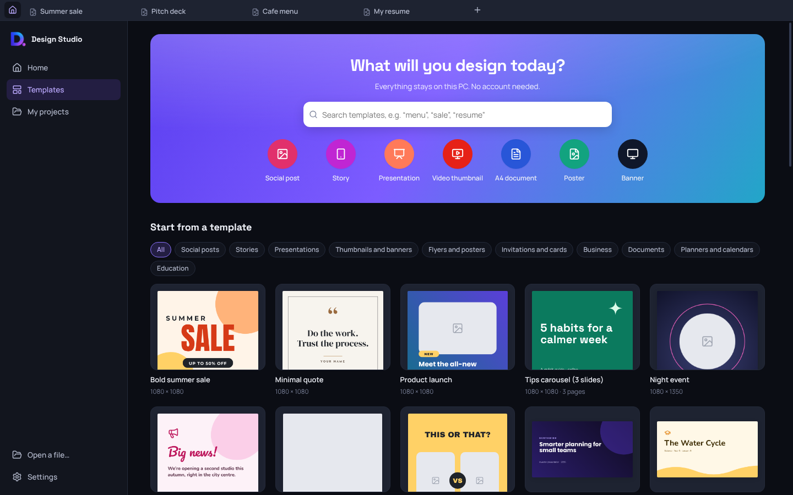

### Edit anything
Click any text to change it. Pick fonts and colours, add outlines, highlights or curved text. Move, resize, rotate, align, group, lock and layer anything.

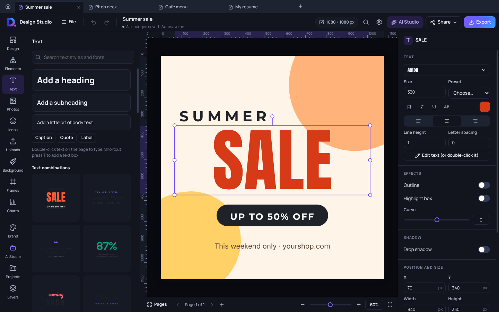

### Work on several designs at once
Each design opens in its own tab at the top, with its own undo history. Switch with a click or **Ctrl+Tab**. Close the app at any time: your tabs and unsaved work are there next time.

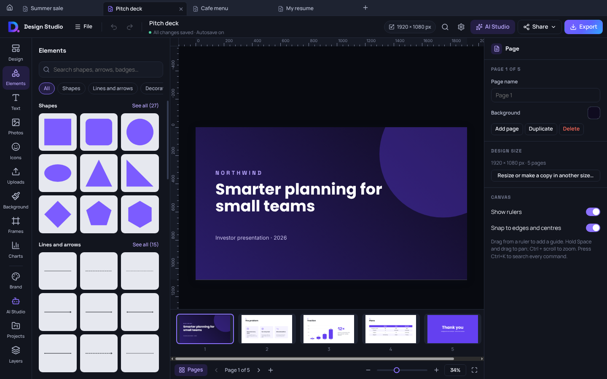

### Elements, icons, charts and tables
Shapes, lines and arrows, badges, frames for photos, about 1,900 icons, and charts and tables you can type your own numbers into.

<p>
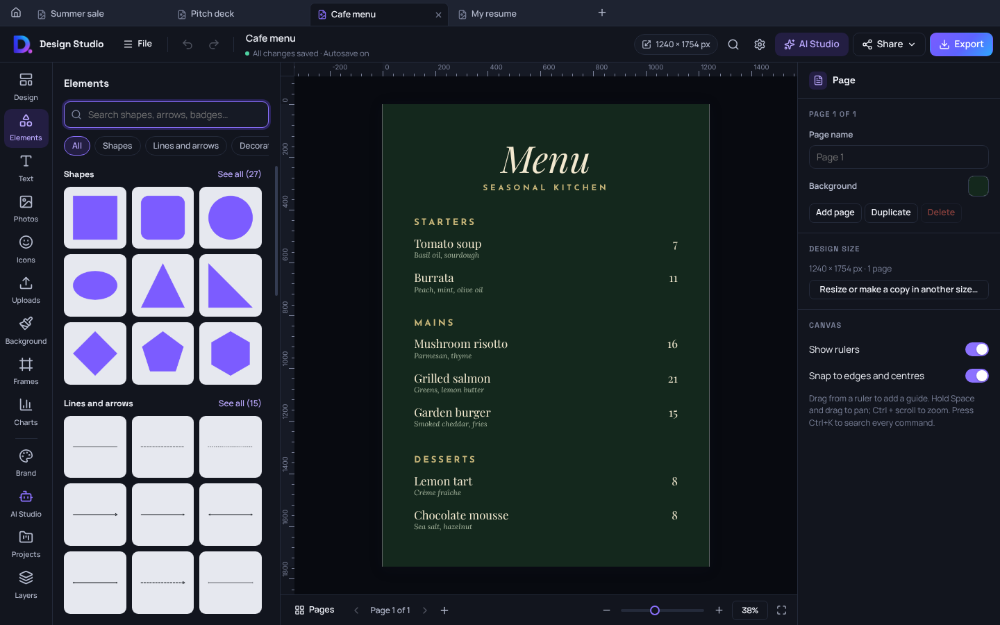
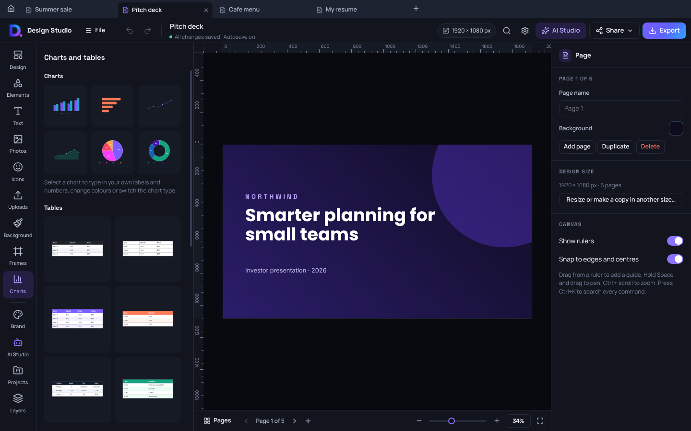
</p>

### Brand kit and your own fonts
Save your brand colours, fonts and logo and apply them with one click. Fonts installed on Windows show up automatically, and you can add `.ttf`, `.otf`, `.woff` or `.woff2` font files.

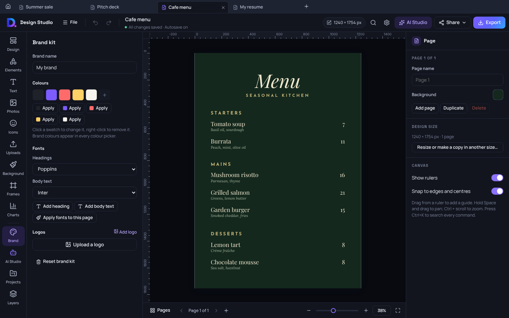

### AI Studio (optional)
Describe a design and get an editable page. Let AI write or rewrite text, translate it, suggest headlines, or tidy a layout ("make the title bigger"). You always review the result before it changes your design.

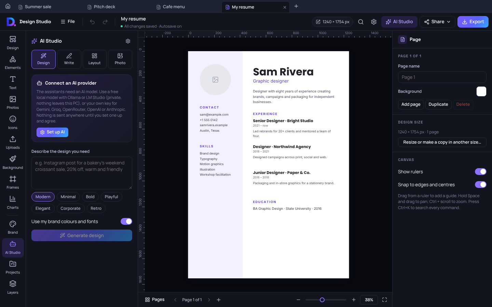

### Download your design
Save as **PNG, JPG, WebP, SVG or PDF** in any size. Multi-page designs can be downloaded as one PDF or as separate images in a ZIP. Need another size? **Resize** makes a copy for another format in one click.

<p>
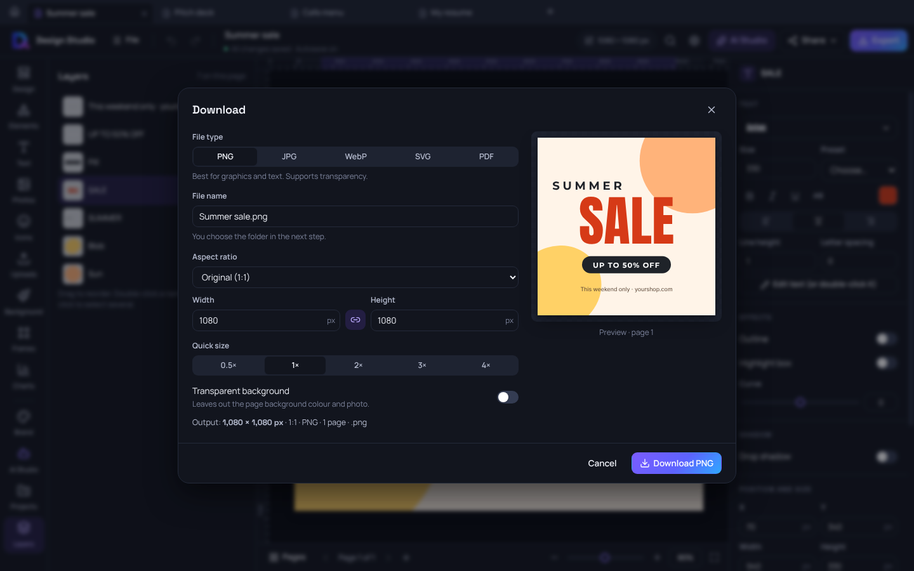
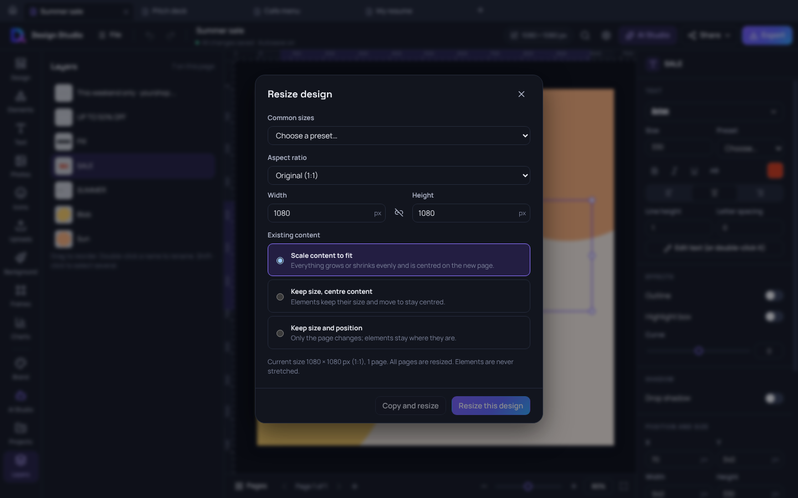
</p>

<details>
<summary><b>More screenshots</b></summary>

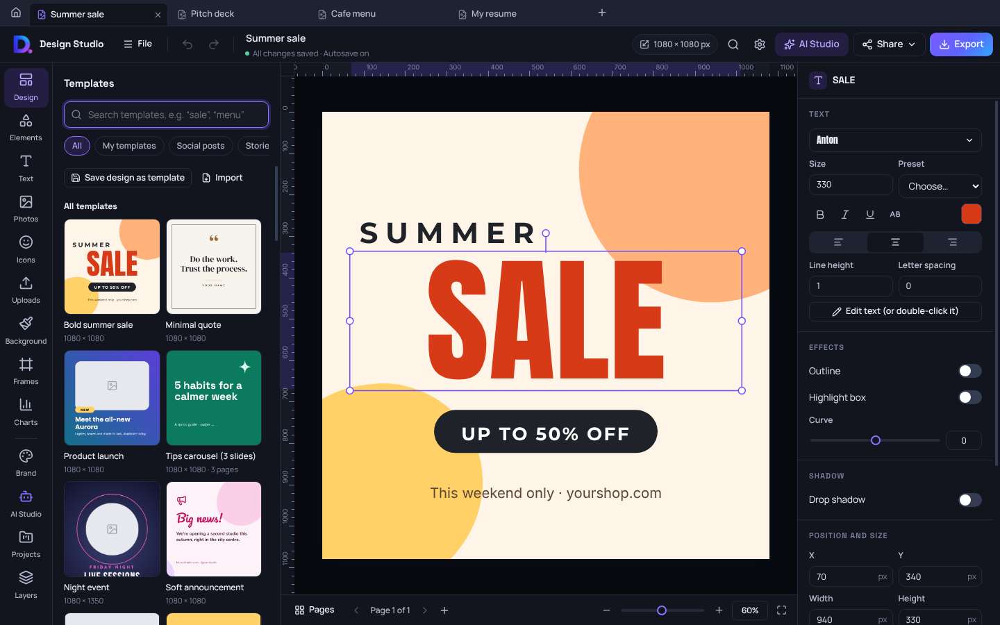
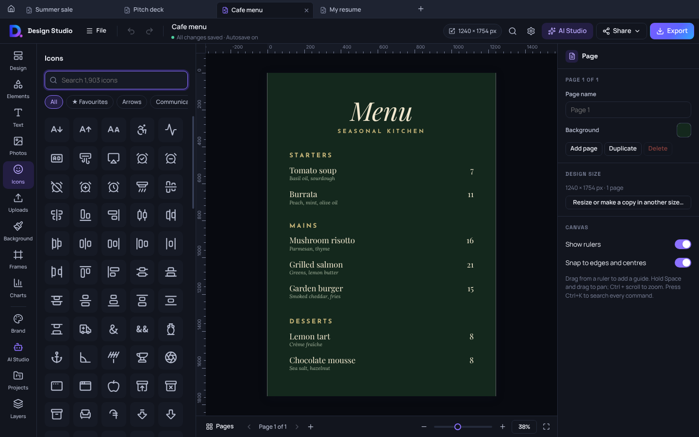
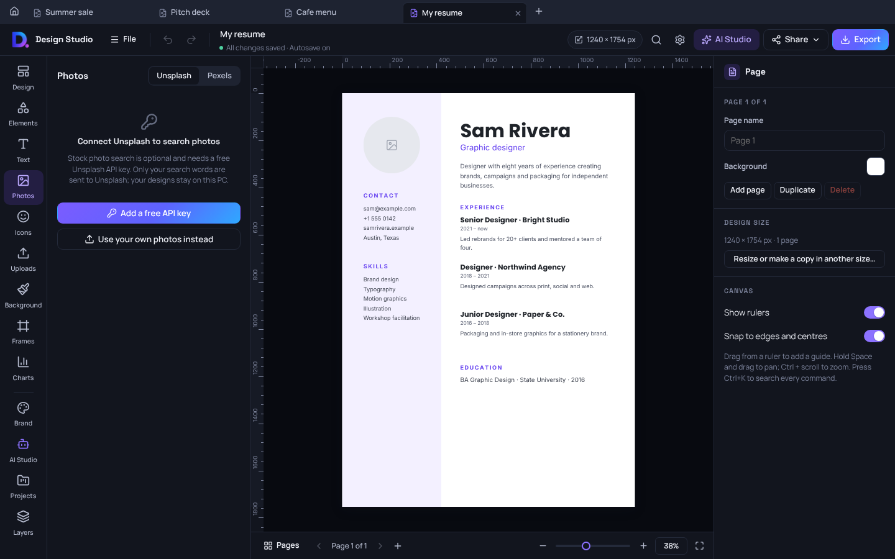
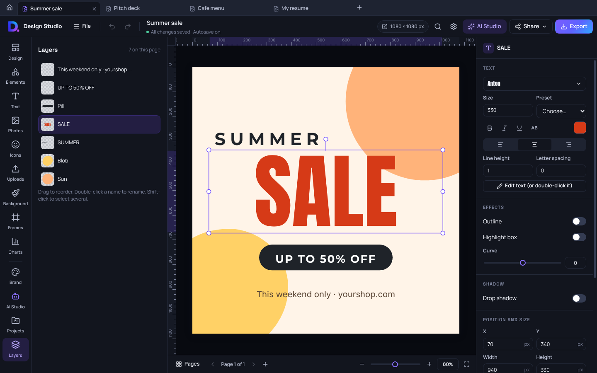
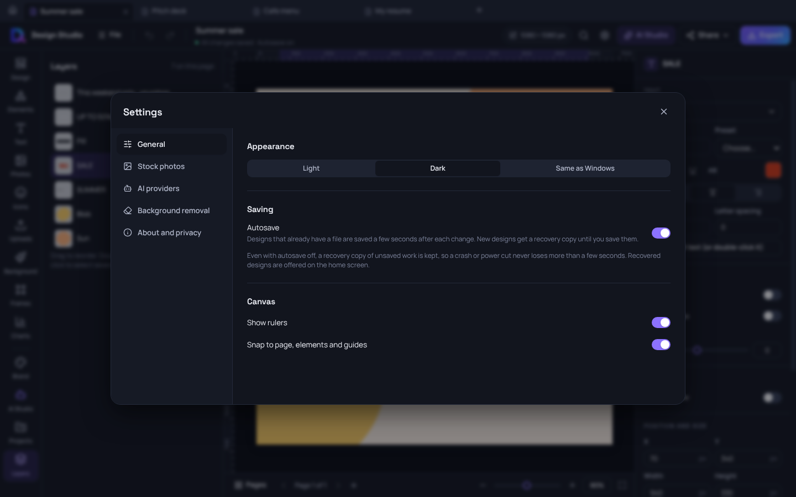

</details>

## Use AI and online extras with your own key

Design Studio works fully without the internet. These extras are **optional** and you set them up in **Settings**:

| Extra | Works with | What you need |
| --- | --- | --- |
| AI design, writing and layout help | **Ollama** or **LM Studio** (free, runs on your PC, nothing leaves it), Google Gemini, Groq, OpenRouter, OpenAI, Anthropic Claude, or any OpenAI-compatible service | A local model, or your own API key |
| AI image generation | Providers that offer image models | Your own API key |
| Stock photo search | Unsplash, Pexels | A free API key |
| Remove image background | remove.bg | Your remove.bg key |

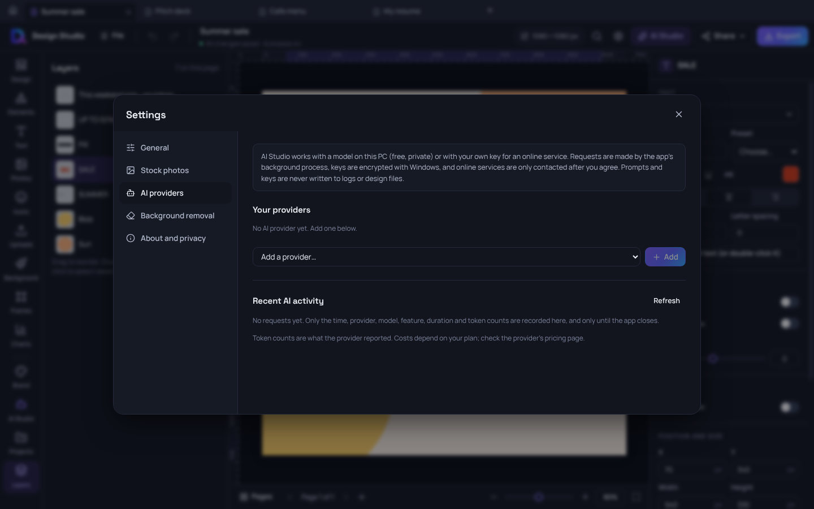

**How your keys and data are protected**
- Keys are encrypted by Windows and stored only on your PC. They are never written into design files, exports or logs.
- Before anything is sent to an online service, the app tells you which service and asks for your OK. You can take it back any time in Settings.
- Only what a feature needs is sent. For example, stock photo search sends your search words; AI writing sends the text you typed.

## Frequently asked questions

**Is Design Studio free?**
Yes. There is no subscription, no trial and no watermark. Online extras you connect (like a paid AI key) are billed by that provider, not by Design Studio.

**Does it work without internet?**
Yes. Everything works offline: templates, editing, fonts, icons, saving and downloading. Internet is only used for the optional extras above.

**Do I need an account or login?**
No. Install it and start designing.

**Is this Canva?**
No. Design Studio is an independent app inspired by how easy tools like Canva work. It does not use Canva's code, templates, images or servers, and it is not connected to Canva. Canva templates cannot be opened in it.

**Where are my designs saved?**
On your PC, as `.odesign` files wherever you choose to save them. Double-click a file to open it. Recent designs also appear on the home screen.

**What if the app or my PC crashes?**
Unsaved work is saved in the background every few seconds. When you open Design Studio again, your tabs come back.

**Can I use my own fonts and photos?**
Yes. Fonts installed on Windows appear automatically, and you can add font files. Drag photos in, paste them, or import them from your PC.

**Does it run on Mac or Linux?**
A macOS app is coming. Today you can already run Design Studio on macOS and any Linux distro from its source code with VS Code, without the Windows installer. The steps are on the [website](https://bhittu21.github.io/canva-offline-alternative/#run-from-source).

**Is it safe? Windows warned me.**
The warning appears because the installer is not code-signed yet, which costs money for new projects. The app is built from the code in this repository by GitHub's own build servers.

## Keyboard shortcuts

Press **?** in the app for the full list, or **Ctrl+K** to search every command.

| Action | Shortcut |
| --- | --- |
| Undo / Redo | Ctrl+Z / Ctrl+Y |
| Save / Download | Ctrl+S / Ctrl+E |
| Next / previous tab | Ctrl+Tab / Ctrl+Shift+Tab |
| Close tab | Ctrl+W |
| Duplicate / Delete | Ctrl+D / Delete |
| Group / Ungroup | Ctrl+G / Ctrl+Shift+G |
| Search commands | Ctrl+K |
| Zoom / Pan | Ctrl + mouse wheel / hold Space and drag |

## What's not there yet

- Text in PDF downloads is not selectable (SVG keeps text as text).
- No video, animation, real-time collaboration or cloud sync.
- Magic eraser, upscaling and image expansion are planned.
- The installer is Windows only for now; macOS and Linux can run it from source.

See the [roadmap](docs/ROADMAP.md) for what's coming. Ideas and bug reports are welcome in [Issues](https://github.com/bhittu21/canva-offline-alternative/issues). If Design Studio helps you, a ⭐ star helps others find it.

<details>
<summary><b>For developers</b></summary>

### Run from source

1. Install **Node.js LTS** from <https://nodejs.org> (the Windows installer, default options).
2. Install **Git** from <https://git-scm.com/download/win> (default options).
3. Open **Command Prompt** and run:

   ```
   cd %USERPROFILE%\Documents
   git clone https://github.com/bhittu21/canva-offline-alternative.git
   cd canva-offline-alternative
   npm install
   npm run dev
   ```

   The first `npm run dev` downloads Electron (about 100 MB), so it needs
   internet once. After that the app only goes online for features you turn on.

To update later: `git pull`, then `npm install`, then `npm run dev`.

To build the installer yourself: `npm run dist`. The `.exe` appears in `dist\`.


### Commands


| Command | What it does |
| --- | --- |
| `npm run dev` | Start the app with live reload |
| `npm test` | Run unit tests |
| `npm run typecheck` | Check TypeScript types |
| `npm run build` | Build the production bundle into `out/` |
| `npm run dist` | Build the Windows installer into `dist/` |

Stack: Electron, React, TypeScript, Vite (electron-vite), Konva, Zustand + Immer,
fflate, zod, pdf-lib, Lucide icons, Fontsource fonts. CI on GitHub's Windows
runners type-checks, tests, builds and produces the installer.

```
src/
  main/       Electron main process: window, menus, dialogs, safe file writes,
              encrypted keys, photo/AI/remove.bg requests, recovery storage
  preload/    the only bridge between the UI and the computer (window.api)
  shared/     document model, file format, presets, AI layout contract
  renderer/   React UI
    src/shell/      top bar, command palette, context menu, confirmations
    src/editor/     Konva canvas, elements, snapping, rulers, commands
    src/panels/     the left rail panels (design, elements, text, photos, ...)
    src/inspector/  the right-hand properties panel
    src/dialogs/    export, resize, settings, shortcuts, save template
    src/library/    templates, elements, text combos, thumbnails
    src/ai/         AI Studio state, consent, layout conversion
    src/render/     shared renderer used by the canvas, exports and thumbnails
    src/io/         open, save, autosave, recovery, image import
tests/unit/   model, history, file format, resize and AI layout tests
```

### Project file format

A `.odesign` file is a zip containing `manifest.json`, `document.json` and an
`assets/` folder with every image the design uses. Files are written to a
temporary file first and then renamed, so a crash while saving cannot damage an
existing design. Older single-page files are upgraded when opened.

### Licences of bundled content

- Icons: [Lucide](https://lucide.dev) (ISC licence)
- Fonts: [Fontsource](https://fontsource.org) packages of Google Fonts (SIL Open Font Licence)
- Templates, text combinations and element shapes: original to this project
- Stock photos are not bundled; they are fetched on demand under the Unsplash or Pexels licence

### Publishing a new version

Raise `version` in `package.json`, then push a tag like `v1.0.1` or run the **Release** workflow from the Actions tab. It builds the installer on GitHub's Windows servers and publishes it as the latest release, so the download link above always points to the newest version.

</details>

---

<sub>Design Studio is an independent project and is not affiliated with, endorsed by or sponsored by Canva. Canva is a trademark of Canva Pty Ltd. Icons from Lucide (ISC licence); fonts from Fontsource (SIL Open Font Licence); templates and shapes are original to this project. Last updated: October 2026.</sub>
